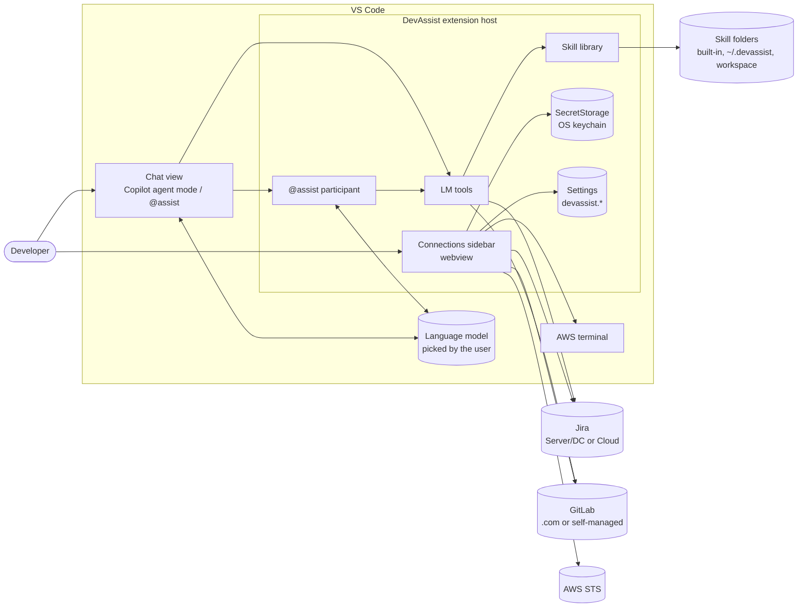
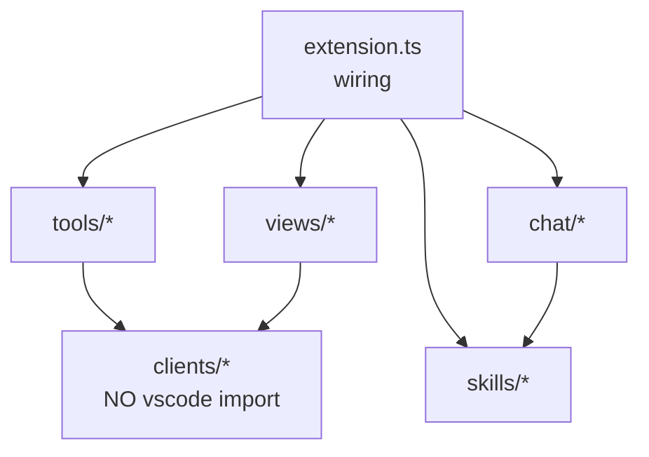
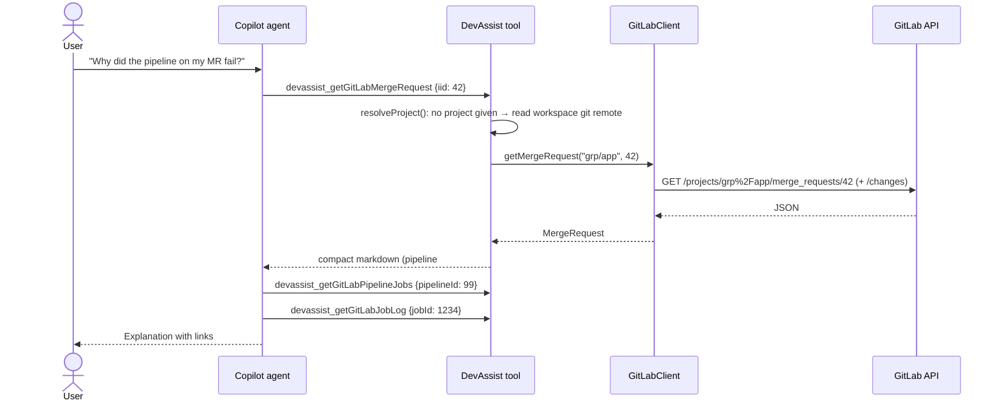
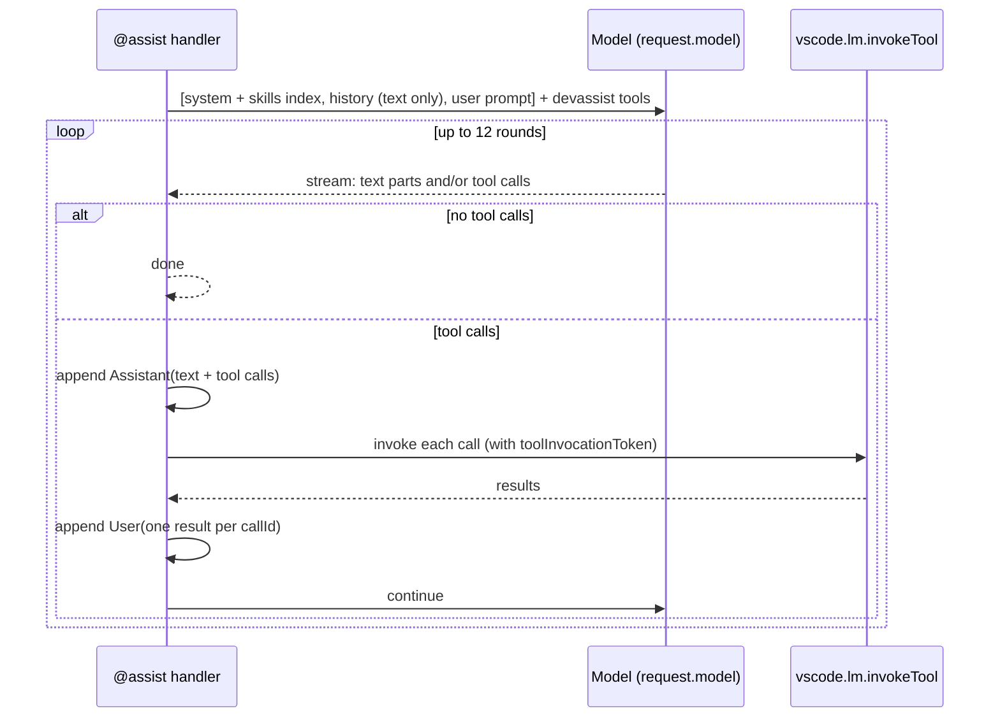
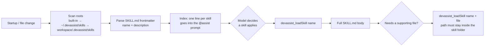
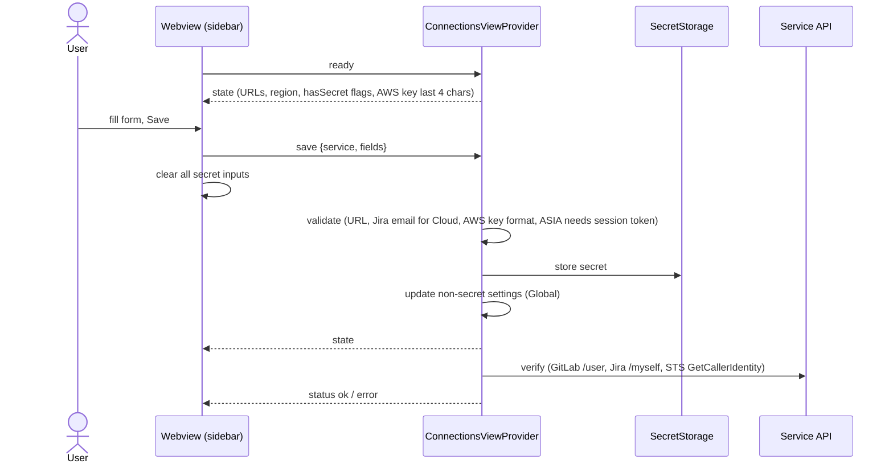

# DevAssist architecture

DevAssist is a VS Code extension that connects VS Code's chat (GitHub Copilot agent mode, and its own
`@assist` participant) to the systems a developer works with every day: Jira, GitLab and AWS. It also adds
**skills**, which are folders of markdown procedures the model loads only when it needs them.

This document explains how the pieces fit together, why they are built the way they are, and how to extend them.
For setup and usage, see the [README](../README.md).

## Contents

1. [Goals and non-goals](#1-goals-and-non-goals)
2. [System context](#2-system-context)
3. [Components](#3-components)
4. [Key flows](#4-key-flows)
5. [Security model](#5-security-model)
6. [Configuration and storage](#6-configuration-and-storage)
7. [Testing](#7-testing)
8. [Design decisions](#8-design-decisions)
9. [Extending DevAssist](#9-extending-devassist)
10. [Known limitations and future work](#10-known-limitations-and-future-work)

---

## 1. Goals and non-goals

**Goals**

- Let the chat model **look things up instead of guessing**: tickets, merge requests, pipelines, CI logs.
- Work with **whatever model the user already has** in VS Code chat. DevAssist ships no model and no API key.
- Keep **credentials out of settings files and out of the model's context**.
- Make **writes explicit**: every tool that changes something asks the user first.
- Let teams **encode their own procedures** (release, incident, AWS networking) as plain markdown, without code changes.
- Stay **small and dependency-free at runtime**: no SDKs bundled, only `fetch` and `node:crypto`.

**Non-goals**

- Not a general GitLab, Jira or AWS client. Tools return only what a model needs, truncated to stay within context limits.
- No AWS API tools (yet). AWS credentials are verified and handed to a terminal; the model doesn't call AWS directly.
- No server component. Everything runs inside the VS Code extension host on the user's machine.

## 2. System context



There are two ways into the tools:

- **Copilot agent mode** discovers DevAssist's tools from `package.json` and calls them itself. DevAssist only
  supplies the tools; Copilot runs the conversation.
- **`@assist`** is DevAssist's own chat participant. It runs its own tool-calling loop with the model the user
  picked, and adds a system prompt, the skills index and slash commands (`/standup`, `/reviews`).

## 3. Components

```
src/
├─ extension.ts              Composition root: builds clients, registers commands, tools, views
├─ auth/secrets.ts           Thin wrapper over vscode.SecretStorage
├─ clients/                  Pure TypeScript, no `vscode` import, unit-tested
│  ├─ jira.ts                Jira REST v2: issue, search (JQL), comment, myself
│  ├─ gitlab.ts              GitLab REST v4: MRs, pipelines, jobs, logs, issues, projects, notes
│  └─ aws.ts                 SigV4 signer + STS GetCallerIdentity
├─ tools/                    vscode.lm.registerTool adapters: input → client call → text result
│  ├─ jiraTools.ts
│  └─ gitlabTools.ts         (+ workspace git remote → GitLab project detection)
├─ chat/participant.ts       @assist request handler and tool loop
├─ skills/
│  ├─ frontmatter.ts         SKILL.md parsing and path-escape check (pure, tested)
│  └─ skills.ts              Skill discovery, index, devassist_loadSkill tool, file watcher
└─ views/connectionsView.ts  WebviewViewProvider for credentials (GitLab, Jira, AWS)
skills/                      Built-in skills shipped inside the .vsix
test/                        node:test unit tests for clients and parsing
media/                       Activity bar icon
```

### Layering rule



`clients/` must never import `vscode`. Clients receive configuration as **functions**
(`() => string`, `() => PromiseLike<token>`) and an injectable `fetchFn`. That means:

- They read the *current* setting and secret on every call, so changes made in the sidebar take effect without a reload.
- They can be unit-tested with `node --test` and a fake `fetch`, with no VS Code test harness.

### Component responsibilities

| Component | Responsibility | Notes |
|-----------|----------------|-------|
| `extension.ts` | Build clients, register everything, own the `devassist.*` commands | Tools are registered *before* the first `await` so they exist even if skill loading is slow |
| `Secrets` | `get` / `has` / `set` / `delete` / `prompt`, change events | Values are trimmed; `onDidChange` keeps the sidebar in sync across windows |
| `JiraClient` | Bearer (Server/DC PAT) or Basic (Cloud email + API token) auth; surfaces Jira's own error messages | Errors are thrown with hints, for example "Check the token with…" |
| `GitLabClient` | `PRIVATE-TOKEN` auth; project paths URL-encoded; log tails cleaned of ANSI codes and section markers; diff budget | `projectFromRemote()` maps a git remote to `group/project` |
| `AwsClient` / `signV4` | Sign STS `GetCallerIdentity` with SigV4; parse XML result and errors | Checked against AWS's published SigV4 example in tests |
| `*Tools.ts` | Map model input to client calls, format compact markdown, catch errors and **return them as text** | Write tools implement `prepareInvocation` with `confirmationMessages` |
| `participant.ts` | System prompt + skills index + history + tool loop (max 12 rounds) | Uses `request.model`, i.e. the model selected in the chat dropdown |
| `SkillLibrary` | Discover skills from three roots, build a one-line-per-skill index, serve full text or supporting files | Later roots override earlier ones by name |
| `ConnectionsViewProvider` | Credential forms, validation, save → verify, remove (with modal confirm), open AWS terminal | Receives secrets *from* the webview, never sends them back |

## 4. Key flows

### 4.1 Tool call from Copilot agent mode



Failures don't throw out of the tool: they come back as text (for example "Fetching !42 failed: GitLab returned
404… Check the project path") so the model can correct its input or tell the user what to fix.

### 4.2 `@assist` tool loop



Ordering matters. The assistant message containing the tool calls must come before the results, and every
call needs exactly one result with the same `callId`. Earlier conversation turns are replayed as **text only**,
which keeps the history valid without storing tool results.

### 4.3 Skills: progressive disclosure



Only the index costs context on every request; full procedures are loaded on demand. Workspace skills reload
automatically through a file watcher, and the reload is coalesced so a burst of file events triggers one scan.

### 4.4 Saving credentials in the sidebar



### 4.5 GitLab project detection

Tools that need a project accept `group/project`, a numeric ID, or nothing / `"current"`. In the last case
`resolveProject()` asks VS Code's built-in Git extension for the workspace repositories' remotes (preferring
`origin`) and keeps the first one whose host matches `devassist.gitlab.baseUrl`. `projectFromRemote()` understands
`https://`, `git@host:` and `ssh://` remotes, and GitLab installed under a sub-path. List tools
(`listGitLabMergeRequests`, `listGitLabIssues`) treat an omitted project as "all projects I can see".

## 5. Security model

| Concern | Control |
|---------|---------|
| Credentials at rest | Stored only in `vscode.SecretStorage` (OS keychain). Never written to `settings.json`. |
| Credentials in the UI | The webview receives `hasSecret` booleans and the last 4 characters of the AWS key ID only. Secret inputs are cleared right after submit. |
| Credentials in the model | Tools never return tokens. The model only sees API results. |
| Webview hardening | Strict CSP: `default-src 'none'`, scripts and styles only with a per-load nonce, no remote resources, `localResourceRoots: []`. |
| Writes | Every write tool (`addJiraComment`, `commentOnGitLabMergeRequest`) shows a confirmation with the exact content before running. Tools are tagged `read` / `write` in the manifest. |
| AWS terminal | Credentials go only into that terminal's environment (`createTerminal({ env })`), not into every terminal through `environmentVariableCollection`. The terminal is `isTransient` so it isn't persisted or restored. `AWS_PROFILE` is unset so a shell profile can't silently override the keys. |
| Least privilege | Docs and hints steer users to a GitLab `read_api` token and temporary or read-only AWS credentials. The STS check needs no IAM permissions. |
| Skill file access | `devassist_loadSkill` resolves the path and refuses anything outside the skill's folder (`../` and absolute paths). |
| Prompt injection | Tool results (ticket text, MR descriptions, CI logs) are untrusted input to the model. Write confirmations are the backstop; the system prompt also says to write only when the user asks. |

## 6. Configuration and storage

| Key | Where | Purpose |
|-----|-------|---------|
| `devassist.jira.baseUrl` | Settings | Jira URL |
| `devassist.jira.authType` | Settings | `bearer` (Server/DC) or `basic` (Cloud) |
| `devassist.jira.email` | Settings | Cloud account email |
| `devassist.gitlab.baseUrl` | Settings | GitLab URL, default `https://gitlab.com` |
| `devassist.aws.region` | Settings | Default region for STS and the AWS terminal |
| `jira.token` | SecretStorage | Jira PAT or API token |
| `gitlab.token` | SecretStorage | GitLab personal access token |
| `aws.credentials` | SecretStorage | JSON `{ accessKeyId, secretAccessKey, sessionToken? }` saved as one value so the parts can't get out of sync |

The sidebar writes settings at **user (Global)** scope. They can still be overridden per workspace in
`.vscode/settings.json` (for example a different Jira per client project).

## 7. Testing

- **Unit tests** (`npm test`) use `node:test` with `--experimental-transform-types`, so there is no build step
  and no test framework dependency. They cover clients and pure helpers: auth headers, URL building and
  encoding, error messages, pagination and scope defaults, diff truncation, log cleaning, remote parsing,
  SigV4 against AWS's published example, and frontmatter parsing.
- **Type checking** (`npm run check-types`) covers `src/` and `test/`.
- **Manual / integration**: press F5 to start an Extension Development Host and use the sidebar's **Test**
  button against real services.

Code that imports `vscode` (tools, view, participant) is kept thin so most logic lives in testable clients.

## 8. Design decisions

| Decision | Why | Trade-off |
|----------|-----|-----------|
| **Expose LM tools rather than only a chat participant** | Copilot agent mode can use them directly alongside its own tools; `@assist` reuses the same tools | Tool descriptions in `package.json` must be written for the model, and are part of the API |
| **Errors returned as tool text, not thrown** | The model can recover (fix JQL, try another project path) and explain the problem to the user | Callers must read the text to know it failed |
| **No vendor SDKs** (hand-written REST, ~60-line SigV4) | Tiny `.vsix`, fast activation, no transitive dependency risk | Each new AWS API call needs signing and parsing by hand; revisit if AWS tools grow |
| **Configuration passed to clients as functions** | Always current, testable without VS Code | Slightly more ceremony in `extension.ts` |
| **History replayed as text only** in `@assist` | Simple and always valid for the model API | The model can't see earlier tool results verbatim, only what it said about them |
| **Skills as markdown with progressive disclosure** | Non-developers can write them; small prompt cost; per-repo overrides | Quality depends on the description triggering the model to load the skill |
| **Webview for credentials** (vs. commands only) | One place to see what's connected, test and remove; supports multi-field forms (Jira Cloud, AWS) | More code than `showInputBox`; needs CSP care |
| **AWS credentials into one transient terminal** | The model can suggest `aws` commands the user runs with the right identity, without global env leakage | Terminal must be reopened after credentials change or expire |

## 9. Extending DevAssist

### Add a service (for example Confluence or Jenkins)

1. **Client**: `src/clients/<service>.ts`. No `vscode` import; take `baseUrl`, credential and `fetchFn` as
   constructor arguments; return small typed objects; throw `Error`s with actionable hints.
2. **Tests**: `test/<service>.test.ts` with a fake `fetch`. Cover auth header, URL encoding, an error path and the
   "not configured" message.
3. **Tools**: `src/tools/<service>Tools.ts`. Format compact markdown, truncate large text, return errors as text.
   Give write tools `confirmationMessages`.
4. **Manifest**: add `languageModelTools` entries in `package.json` with tags `["devassist", "<service>", "read"|"write"]`,
   a precise `modelDescription` (what it returns and when to use it), an `inputSchema` with `required`, and optionally
   `toolReferenceName` for `#references`.
5. **Credentials**: add a section to `connectionsView.ts` (form, `save`, `test`, `clear`) and a secret key constant.
6. **Wire**: construct the client and register its tools in `extension.ts`.
7. **Docs**: README tool table and this document.

### Add a skill

Create `skills/<name>/SKILL.md` (built-in), `~/.devassist/skills/<name>/SKILL.md` (personal) or
`<repo>/.devassist/skills/<name>/SKILL.md` (team, committed). The `description` is all the model sees until it
loads the skill, so say **what** it does and **when** to use it. Put long reference material in supporting files
and point to them from `SKILL.md`.

### Add an `@assist` slash command

Add an entry to `chatParticipants[0].commands` in `package.json` and a prompt to `COMMAND_PROMPTS` in
`src/chat/participant.ts`.

## 10. Known limitations and future work

- **No AWS tools for the model.** Natural next step: read-only `describe-*` tools (VPCs, route tables, security
  groups, Reachability Analyzer) behind the stored credentials, for the `aws-network-engineer` skill. At that point,
  re-evaluate the AWS SDK vs. hand signing.
- **No SSO / profile support for AWS.** Only static or temporary keys pasted in. Supporting `~/.aws/config`
  profiles or IAM Identity Center would avoid long-lived keys.
- **No OAuth.** GitLab and Jira use personal tokens. VS Code's `AuthenticationProvider` API could add sign-in flows.
- **No pagination beyond the first page.** List tools return up to 20–50 items by design; narrower filters are
  expected.
- **Single GitLab and Jira instance** per user (overridable per workspace through settings, but tokens are global).
- **No integration tests** against the VS Code API (`@vscode/test-electron`); the sidebar and tools are verified manually.
- **`@assist` history is text-only**, so follow-up questions may re-run tools the previous turn already ran.
